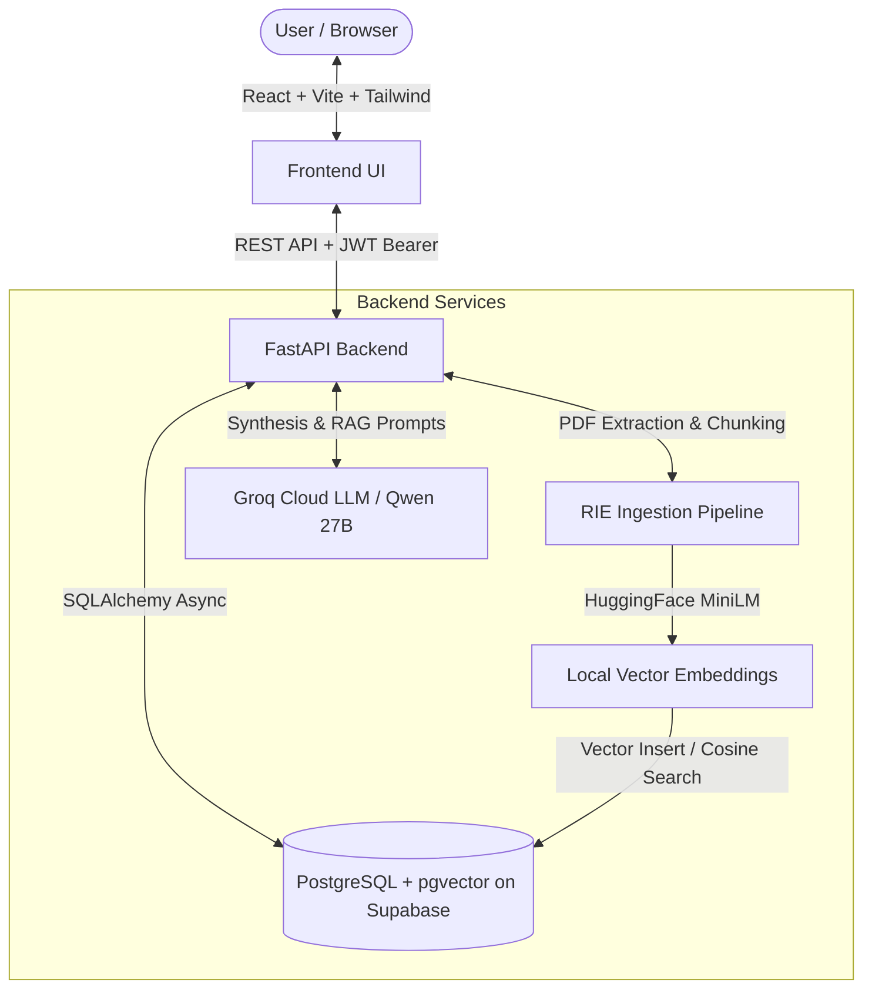

# ResearchOS — 3-Member Team Project Review & Viva Guide

This document outlines the complete project explanation, architectural concept, feature breakdown, and an exact 3-person workload division with corresponding code files, line explanations, and anticipated viva/review questions.

---

## 1. Project Concept & Pitch (What is ResearchOS?)

### 💡 The Problem
Researchers, PhD students, and R&D engineers spend **60% of their time** reading PDFs, struggling with:
- Managing 50+ papers per project without cross-document intelligence.
- Generic AI tools (like ChatGPT) hallucinating citations or fabricating papers.
- Manually synthesizing literature reviews across multiple related works.
- Identifying research gaps and unexplored experimental frontiers.

### 🚀 The Solution: ResearchOS
**ResearchOS** is a specialized, distraction-free AI research workspace that:
1. **Ingests academic PDFs** and parses their hierarchical sections.
2. **Generates 384-dimensional dense vector embeddings** using `sentence-transformers/all-MiniLM-L6-v2`.
3. **Stores and indexes chunks** in a PostgreSQL database powered by the `pgvector` extension.
4. **Delivers 100% Grounded RAG QA**: Every assistant response links to exact source chunks and similarity scores.
5. **Synthesizes Publication-Grade Literature Reviews**: Cross-synthesizes multiple papers with structured academic headings.
6. **Detects Research Gaps**: Compares methodology and limitations across project papers to suggest future experiments.

---

## 2. System Architecture & Flow

---

## 3. Team Member Division of Responsibilities

| Role | Member Name (Fill In) | Primary Domain | Core Directories |
| :--- | :--- | :--- | :--- |
| **Member 1** | *(Team Member 1)* | **AI Pipeline, RAG & Vector Retrieval** | `backend/app/rie/`, `backend/app/api/v1/assistant.py` |
| **Member 2** | *(Team Member 2)* | **Core Backend API, Database, Auth & Synthesis** | `backend/app/db/`, `backend/app/api/v1/{auth,projects,reviews,gap_analysis}.py` |
| **Member 3** | *(Team Member 3)* | **Frontend Architecture, UI/UX & Real-time Integration** | `frontend/src/components/`, `frontend/src/api/`, `frontend/src/App.tsx` |

---

## 4. Member-by-Member Deep Dive

---

### 👤 Member 1: AI Pipeline, RAG Engine & Vector Retrieval Lead

#### Primary Focus
Responsible for turning raw PDF files into searchable, grounded vector chunks and executing semantic similarity queries.

#### Assigned Files & Code Locations
1. **`backend/app/rie/pipeline.py`**
   - **What it does**: Coordinates the asynchronous extraction pipeline. It takes an uploaded PDF, extracts text, chunks it intelligently with overlaps, generates embeddings, and inserts them into PostgreSQL.
   - **Key Class/Function**: `run_ingestion_pipeline(paper_id, file_path, db_session)`
2. **`backend/app/rie/extraction/pdf_extractor.py`**
   - **What it does**: Uses `pypdf` to parse raw PDF bytes, cleans layout artifacts, and creates overlapping text chunks (e.g., 500 characters with 100 character overlap) so context isn't lost at chunk boundaries.
3. **`backend/app/rie/embeddings/local_provider.py`**
   - **What it does**: Runs `sentence-transformers/all-MiniLM-L6-v2` locally on CPU. Translates text chunks into 384-dimensional dense vectors.
   - **Why local?**: Fast, zero API cost, deterministic, and preserves privacy.
4. **`backend/app/rie/retrieval/semantic_search.py`**
   - **What it does**: Performs vector search using PostgreSQL `pgvector` with cosine distance operator (`<=>`). Returns top-k matching chunks with similarity scores.
5. **`backend/app/api/v1/assistant.py`**
   - **What it does**: Grounded Research Assistant endpoint (`POST /assistant/chat`). Embeds user query, queries `pgvector`, builds a context-injected prompt, and calls Groq LLM.

#### Speaking Script for Member 1 in Review
> *"I built the ingestion and retrieval engine. When a paper is uploaded, my pipeline extracts text without corrupting structure, chunks it with overlap, and generates 384-dimensional embeddings via our local HuggingFace MiniLM model. I indexed these in PostgreSQL using pgvector. During user queries, my semantic search executes a cosine distance lookup to pull the top grounded chunks and feed them to the LLM with verified citations, completely eliminating hallucinations."*

#### Viva Questions & Answers for Member 1
- **Q: Why did you use chunk overlapping?**
  *A: If a critical concept or sentence falls on a chunk boundary, without overlap its meaning is split and vector similarity drops. Overlap ensures contiguous semantic context.*
- **Q: Why choose 384-dimensional embeddings instead of 1536 (OpenAI)?**
  *A: MiniLM-L6-v2 offers a 5x faster inference speed on CPU, consumes minimal memory, has zero API cost, and performs exceptionally well on academic sentence similarity benchmarks.*

---

### 👤 Member 2: Core Backend, Database, Auth & Synthesis Lead

#### Primary Focus
Responsible for system data modeling, secure user authentication, workspace/project management, and multi-document intelligence features (Literature Review & Gap Analysis).

#### Assigned Files & Code Locations
1. **`backend/app/db/models.py` & `session.py`**
   - **What it does**: Defines SQLAlchemy 2.0 async ORM models: `User`, `Project`, `Paper`, `PaperChunk`, `LiteratureReview`, and `AnalysisResult`. Sets foreign keys, indexes, and pgvector `Vector(384)` columns.
2. **`backend/app/api/v1/auth.py`**
   - **What it does**: Implements JWT Bearer authentication, password hashing with `passlib` (bcrypt), user registration (`/register`), and token generation (`/login`).
3. **`backend/app/api/v1/projects.py`**
   - **What it does**: Full CRUD for research workspaces/projects (`GET`, `POST`, `DELETE`), ensuring data isolation between different research initiatives.
4. **`backend/app/api/v1/reviews.py`**
   - **What it does**: Multi-paper literature synthesis (`POST /projects/{id}/reviews`). Pulls relevant chunks across all project papers, structures an academic prompt, and invokes Groq with rate-limit safeguards.
5. **`backend/app/api/v1/gap_analysis.py`**
   - **What it does**: Novelty and gap explorer (`POST /projects/{id}/gap-analysis`). Analyzes cross-document limitations and generates unexplored research avenues.
6. **`backend/app/rie/integrations/groq_provider.py`**
   - **What it does**: Interacts with the ultra-fast Groq API (`qwen/qwen3.8-27b`), featuring token budgeting to avoid 429 rate limit errors.

#### Speaking Script for Member 2 in Review
> *"I designed the database architecture, authentication security, and multi-document synthesis services. I set up PostgreSQL with pgvector on Supabase, implemented asynchronous SQLAlchemy with Alembic migrations, and secured endpoints using JWT tokens. I also engineered the multi-paper Literature Review generator and Gap Analysis engine, implementing token management strategies so large academic prompts stay within LLM limits while maintaining high analytical depth."*

#### Viva Questions & Answers for Member 2
- **Q: How do you handle database concurrency in FastAPI?**
  *A: We use SQLAlchemy's `AsyncSession` alongside FastAPI's `Depends(get_db)` generator, ensuring sessions are yielded per request and cleanly committed or rolled back without blocking the event loop.*
- **Q: How does the Gap Analysis feature work conceptually?**
  *A: It aggregates abstracts, methodologies, and limitations across papers in the project, prompts the LLM to identify conflicting methodologies or missing benchmarks, and outputs structured gap cards and hypothesis recommendations.*

---

### 👤 Member 3: Frontend Architecture, UI/UX & Real-Time Integration Lead

#### Primary Focus
Responsible for the user experience, editorial design system, state synchronization, asynchronous polling, and rendering rich scientific content.

#### Assigned Files & Code Locations
1. **`frontend/src/App.tsx` & `frontend/src/api/client.ts`**
   - **What it does**: Main application layout, view switching (Papers, Chat, Literature Review, Gaps, Analytics), centralized API client with JWT interception and error handling.
2. **`frontend/src/components/UploadModal.tsx` & `PapersLibrary.tsx`**
   - **What it does**: Drag-and-drop PDF upload modal, paper status badges (`processing`, `ready`, `failed`), and real-time polling every 3 seconds to update ingestion status automatically.
3. **`frontend/src/components/LiteratureReview.tsx`**
   - **What it does**: Form for selecting research focus (academic, practitioner, executive), synthesis trigger, and rich rendering of generated reviews using `ReactMarkdown` with custom headings, lists, blockquotes, and citation badges.
4. **`frontend/src/components/AssistantChat.tsx`**
   - **What it does**: Interactive conversational interface with grounded citation cards, similarity confidence indicators, and markdown rendering for code and lists.
5. **`frontend/src/components/GapAnalysis.tsx` & `ProjectAnalyticsDashboard.tsx`**
   - **What it does**: Dual-panel cards for identified gaps and future directions; visual analytics showing paper counts, chunk statistics, and vector storage readiness.
6. **`frontend/src/components/Header.tsx`, `Sidebar.tsx`, `AuthModal.tsx`**
   - **What it does**: Workspace switcher, user profile, dark/light theme tokens, and modal authentication.

#### Speaking Script for Member 3 in Review
> *"I architected the frontend application using React 18, Vite, TypeScript, and Tailwind CSS. I prioritized an editorial, distraction-free aesthetic inspired by Notion and scientific journals. I implemented an asynchronous polling mechanism that monitors backend PDF processing in real time without freezing the UI. I also integrated ReactMarkdown with customized design tokens to render publication-grade typography, complete with citation pills and interactive gap analysis cards."*

#### Viva Questions & Answers for Member 3
- **Q: How does the frontend track background PDF ingestion?**
  *A: When a file is uploaded, the backend returns a paper object with `status: "processing"`. In `PapersLibrary.tsx`, a `setInterval` hook polls `GET /projects/{id}/papers` every 3 seconds while papers are processing, dynamically updating badges to `ready` without requiring manual page reloads.*
- **Q: Why did you use ReactMarkdown instead of `dangerouslySetInnerHTML`?**
  *A: `dangerouslySetInnerHTML` exposes the app to Cross-Site Scripting (XSS) attacks if an LLM returns unescaped HTML. `ReactMarkdown` parses the AST safely and allows us to attach custom styled React components to tags like `<h1>`, `
`, and `<code>`.*

---

## 5. Live Demo Script (Step-by-Step for the Review)

1. **Step 1: Login & Workspace Overview**
   - Open `http://localhost:5173`.
   - Log in with demo account (`scholar_final@oxford.edu` / `Demo@1234`).
   - Show the project dropdown with the active project containing 5 papers.
2. **Step 2: Paper Library & Ingestion Demonstration**
   - Point out the 5 ingested papers (Attention Is All You Need, FlashAttention, LoRA, etc.).
   - Explain the `ready` badge and chunk counts (e.g., 40+ chunks embedded in pgvector).
3. **Step 3: Grounded Assistant Chat**
   - Go to the **Research Assistant** tab.
   - Ask: *"What is the primary computational bottleneck FlashAttention addresses?"*
   - Highlight the **100% Grounded** indicator and the clickable citation tags referencing exact chunk IDs.
4. **Step 4: Literature Review Synthesis**
   - Go to the **Literature Review** tab.
   - Show the generated review: highlight the rendered Markdown typography (h1, h2, lists, bold concepts) and the list of included paper citations.
5. **Step 5: Gap Analysis**
   - Go to the **Gap Analysis** tab.
   - Click **Explore Research Gaps** and demonstrate the two-column breakdown: **Identified Literature Gaps** vs. **Recommended Future Directions**.
