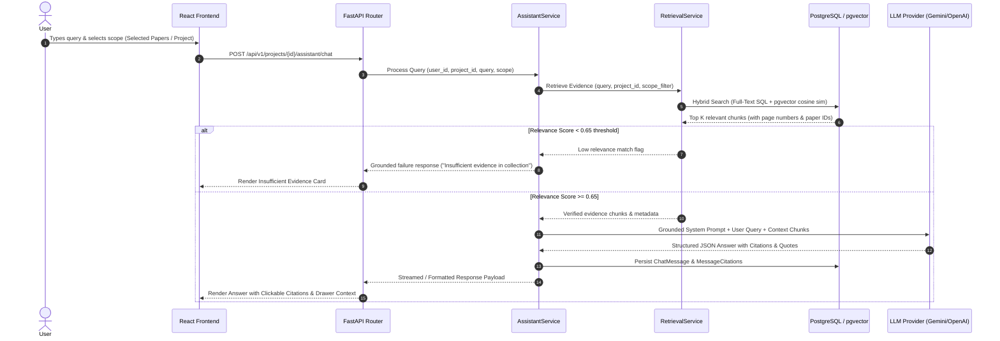

# ResearchOS — Workflows & State Machines Specification
**Version**: 1.0.0  
**Status**: Frozen Architectural Specification  

---

## 1. Overview
This specification details the state transitions, data flow pipelines, error-recovery loops, and validation checks across all core workflows in ResearchOS.

---

## 2. Document-Processing Workflow & Lifecycle

### 2.1 State Transition Model
A uploaded PDF transitions through distinct stages tracked in the `processing_jobs` table:

```
[UPLOADED] ──► [VALIDATING_FILE] ──► [EXTRACTING_TEXT] ──► [CHUNKING]
                                              │                │
                                              ▼                ▼
                                       (Empty/Scanned)   (Clean Chunks)
                                              │                │
                                              ▼                ▼
                                      [REQUIRES_OCR]   [EXTRACTING_METADATA]
                                                               │
                                                               ▼
                                                      [VALIDATING_EVIDENCE]
                                                               │
                                                               ▼
                                                      [INDEXING_VECTORS]
                                                               │
                                                               ▼
                                                            [READY]
```

### 2.2 Stage Matrix & Error Handling

| State | Responsible Service | Action / Processing | Failure Action | Next Valid State |
|---|---|---|---|---|
| `QUEUED` | `JobDispatcher` | Job enqueued in background queue. | Retried up to 3 times. | `VALIDATING_FILE` |
| `VALIDATING_FILE` | `PDFExtractionService` | Verifies magic bytes `%PDF-`, size < 50MB, calculates SHA256. | Marks `FAILED_INVALID_FILE`. | `EXTRACTING_TEXT` |
| `EXTRACTING_TEXT` | `PDFExtractionService` | PyMuPDF extracts raw text, preserving page numbers & coordinates. | If 0 text extracted, transitions to `REQUIRES_OCR`. | `CHUNKING` or `REQUIRES_OCR` |
| `CHUNKING` | `PDFExtractionService` | Section-aware chunking (512 tokens, 64 token overlap). | Marks `FAILED_CHUNKING`. | `EXTRACTING_METADATA` |
| `EXTRACTING_METADATA` | `MetadataExtractionService` | Structured LLM prompt targeting JSON schema for methods, datasets, etc. | Retries transient LLM timeouts. | `VALIDATING_EVIDENCE` |
| `VALIDATING_EVIDENCE` | `EvidenceValidator` | Verifies extracted quotes against chunk text provenance. | Flags low-confidence fields (`NEEDS_REVIEW`). | `INDEXING_VECTORS` |
| `INDEXING_VECTORS` | `EmbeddingService` | Generates 768d embeddings, inserts into `chunk_embeddings` pgvector table. | Retries indexing without re-triggering metadata. | `READY` |
| `READY` | `PaperService` | Paper status set to active, available for all intelligence tools. | N/A | Terminal Success |

---

## 3. Workspace AI Assistant Workflow

### 3.1 Retrieval-Augmented Generation (RAG) Flow



---

## 4. Literature Review Synthesis Pipeline

### 4.1 Section-by-Section Synthesis Workflow
To avoid LLM context collapse and guarantee accurate citations:

1. **Scope Selection**: User selects $N$ papers and chooses Review Type (`Chronological`, `Thematic`, or `Methodological`).
2. **Outline Generation**: RIE analyzes paper abstracts and metadata summaries to produce a 4–6 section outline.
3. **Outline Approval**: User edits, reorders, or adds section titles in the UI.
4. **Section Generation Loop**:
   - For each section heading, `ReviewService` fetches relevant paper chunks tagged with that theme.
   - LLM generates section text with inline citation placeholders `[Paper_ID, Page_N]`.
   - `EvidenceValidator` verifies inline citations against selected paper chunks.
   - Section saved to database as editable artifact version.
5. **Final Assembly & Export**: Review rendered as editable document; ready for DOCX / PDF export.

---

## 5. Research Gap Analyzer Engine

### 5.1 Dual-Layer Gap Detection Methodology

```
┌────────────────────────────────────────────────────────┐
│               LAYER 1: DETERMINISTIC MATRIX            │
│  SQL Aggregations over Validated Paper Metadata        │
│                                                        │
│  - Method Distribution (e.g. CNN: 60%, ViT: 20%)       │
│  - Dataset Matrix (e.g. ImageNet: 15, Custom: 2)       │
│  - Stated Limitation Frequency (e.g. Small Data: 12)   │
└──────────────────────────┬─────────────────────────────┘
                           │
                           ▼
┌────────────────────────────────────────────────────────┐
│             LAYER 2: LLM CANDIDATE SYNTHESIS           │
│  Context: Matrices + Extracted Future Work Quotes      │
│                                                        │
│  - Identifies under-explored Method-Dataset pairs      │
│  - Cross-references conflicting empirical results      │
│  - Synthesizes candidate gap titles & descriptions      │
└──────────────────────────┬─────────────────────────────┘
                           │
                           ▼
┌────────────────────────────────────────────────────────┐
│            LAYER 3: EVIDENCE PROVENANCE CHECK          │
│  Links candidate gaps to supporting & counter-evidence │
│                                                        │
│  - Confidence Score assigned (High / Medium / Low)     │
│  - Tagged: "Measured Gap in Uploaded Collection"       │
└────────────────────────────────────────────────────────┘
```
